# Day 3 – Custom Endpoint Detections

## Objective

The aim of Day 3 was to take the process activity investigated during Day 2 and turn it into custom Wazuh detection rules.

I started by using Windows Security Event ID 4688 to detect specific process and parent process relationships. I then expanded the rules using Sysmon Event IDs 1 and 3 to detect other activity, including encoded PowerShell execution, outbound network connections and executables running from Downloads or temporary directories.

Five custom detection rules were created and tested.

---

## Custom Wazuh Rules

I added the rules to the Wazuh `local_rules.xml` file:

`/var/ossec/etc/rules/local_rules.xml`

The rules were:

- `100200` – `whoami.exe` launched from `cmd.exe`
- `100201` – `ipconfig.exe` launched from `cmd.exe`
- `100202` – Document application launching encoded PowerShell
- `100203` – PowerShell making an outbound TCP connection
- `100204` – Executable launched from Downloads or temporary directories

The first two rules use Wazuh process creation rule `67027`. The other three use Sysmon process creation and network connection events.

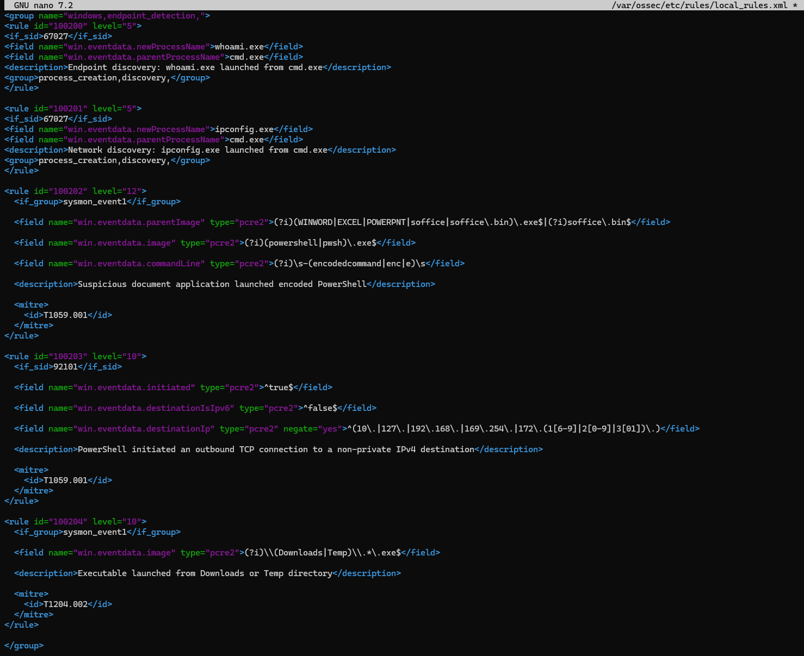

Before restarting Wazuh, I checked the configuration using:

```bash
sudo /var/ossec/bin/wazuh-analysisd -t
```

The configuration passed without errors, and I restarted the Wazuh manager to apply the rules.

---

## Rule 100200 – Whoami Detection

The first rule detects `whoami.exe` when it is launched from `cmd.exe`.

To test it, I opened Command Prompt on `SOC-ENDPOINT-01` and ran:

```cmd
whoami
```

Wazuh captured the process creation using Windows Security Event ID 4688.

The event showed:

- Command line: `whoami`
- New process: `C:\Windows\System32\whoami.exe`
- Parent process: `C:\Windows\System32\cmd.exe`
- Event ID: `4688`

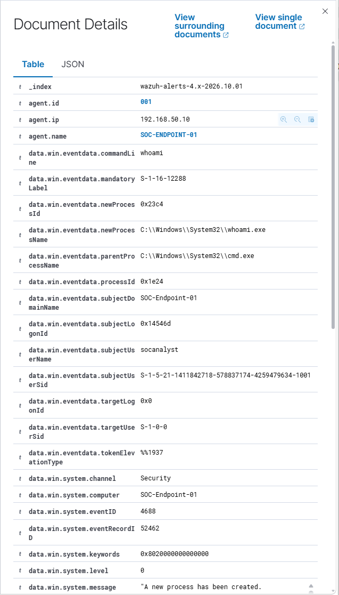

The activity matched rule `100200` and generated a level 5 Wazuh alert.

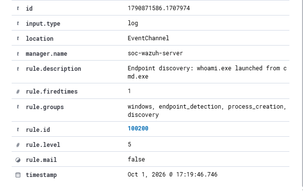

---

## Negative Test

I also ran `whoami` from PowerShell instead of Command Prompt.

The process was still recorded using Event ID 4688, but the parent process was now:

`C:\Windows\System32\WindowsPowerShell\v1.0\powershell.exe`

Instead of:

`C:\Windows\System32\cmd.exe`

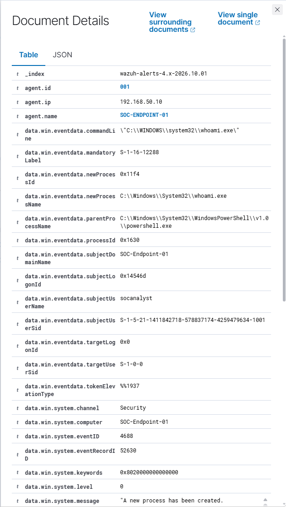

This showed why the parent process is useful when creating detection rules. Although the same executable was running, the process relationship was different and did not meet the conditions of rule `100200`.

---

## Rule 100201 – Ipconfig Detection

The second rule detects `ipconfig.exe` when it is launched from `cmd.exe`.

I tested the rule by running:

```cmd
ipconfig
```

Wazuh recorded the process using Windows Security Event ID 4688.

The event showed:

- Command line: `ipconfig`
- New process: `C:\Windows\System32\ipconfig.exe`
- Parent process: `C:\Windows\System32\cmd.exe`
- Event ID: `4688`

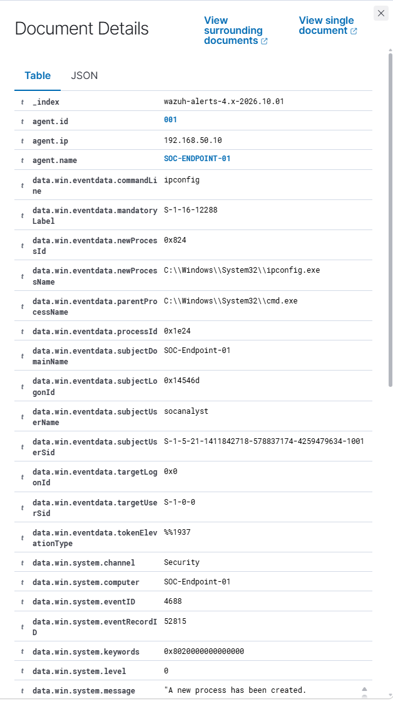

Rule `100201` matched the activity and generated a level 5 alert.

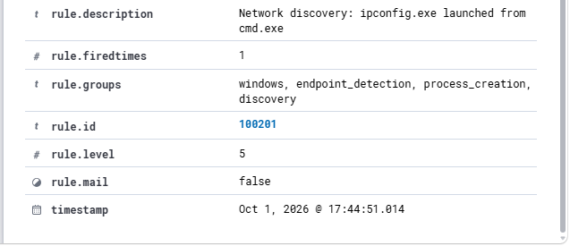

---

## Rule 100202 – Encoded PowerShell Detection

For the third rule, I wanted to detect PowerShell being launched from a document application with an encoded command.

This type of behaviour can be suspicious because malicious documents sometimes use PowerShell to execute commands.

I used Sysmon Event ID 1 and created a rule that checks:

- Whether the parent process is a document application such as Microsoft Office or LibreOffice
- Whether the child process is PowerShell
- Whether the command line contains an encoded command argument

I tested the rule using LibreOffice to launch PowerShell with the `-EncodedCommand` argument.

The event showed:

- Parent process: `soffice.bin`
- Child process: `powershell.exe`
- Command-line argument: `-EncodedCommand`
- Sysmon Event ID: `1`

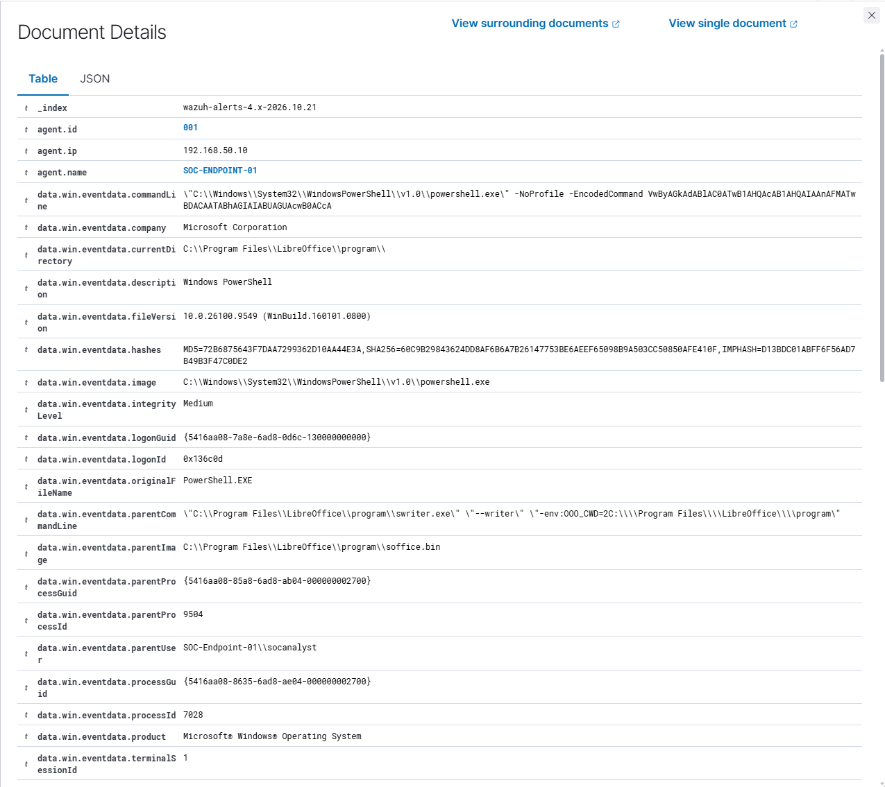

Wazuh matched the activity to rule `100202` and generated a level 12 alert.

The rule was mapped to MITRE ATT&CK technique `T1059.001` – PowerShell.

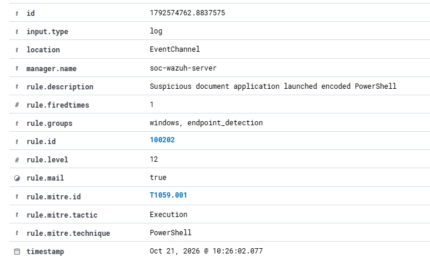

This confirmed that the rule could identify encoded PowerShell execution when launched from a document application.

---

## Rule 100203 – PowerShell Network Connection

The fourth rule was created to detect PowerShell initiating an outbound TCP connection to a non-private IPv4 address.

I used Sysmon Event ID 3, which records network connections.

The rule checks whether PowerShell initiated the connection and whether the destination is outside the private, loopback and link-local IPv4 ranges included in the rule's exclusions.

To test it, I ran the following command in PowerShell:

```powershell
Invoke-WebRequest -Uri "https://www.wikipedia.org" -UseBasicParsing -TimeoutSec 15
```

Wazuh recorded the connection with the following details:

- Process: `powershell.exe`
- Destination IP: `185.15.59.224`
- Destination hostname: `text-lb.esams.wikimedia.org`
- Destination port: `443`
- Protocol: `TCP`
- Connection initiated: `true`
- Sysmon Event ID: `3`

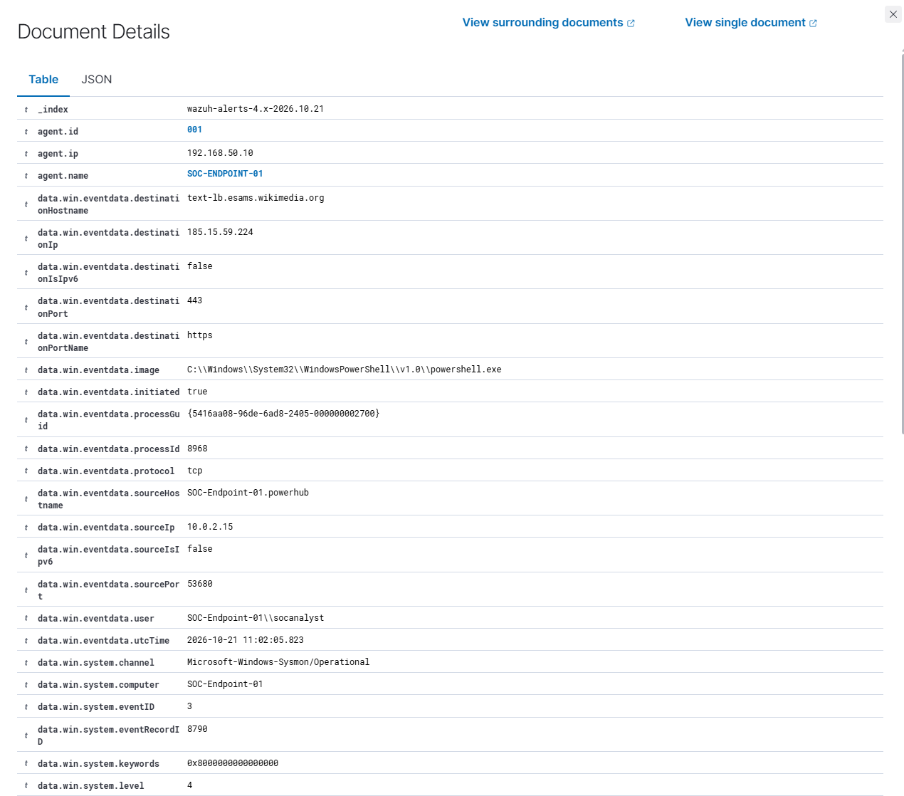

The connection triggered rule `100203` and generated a level 10 alert.

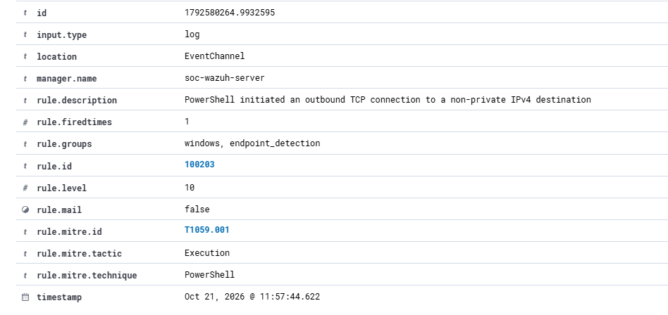

The test showed that Wazuh could detect PowerShell making an outbound network connection.

However, this was a legitimate connection to Wikipedia. The rule detects the behaviour, but the connection itself does not necessarily mean anything malicious has happened.

---

## Rule 100204 – Executable Launched from Downloads or temporary directories

The fifth rule detects executable files launched from Downloads or temporary directories.

I created this rule because these locations can be used to store downloaded files or stage executables before running them.

The rule uses Sysmon Event ID 1 and checks the executable's file path.

To test it, I copied the legitimate Windows `whoami.exe` executable into the Downloads folder and renamed it `lab-test.exe`.

I used PowerShell to run:

```powershell
Copy-Item "$env:WINDIR\System32\whoami.exe" "$env:USERPROFILE\Downloads\lab-test.exe"
& "$env:USERPROFILE\Downloads\lab-test.exe"
```

The event showed:

- Executable: `C:\Users\socanalyst\Downloads\lab-test.exe`
- Original filename: `whoami.exe`
- Parent process: `powershell.exe`
- Sysmon Event ID: `1`

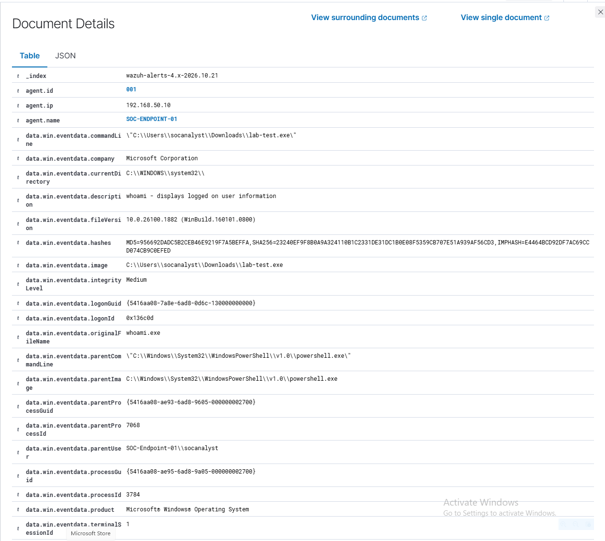

Rule `100204` successfully matched the activity and generated a level 10 alert.

The rule was mapped to MITRE ATT&CK technique `T1204.002` – Malicious File.

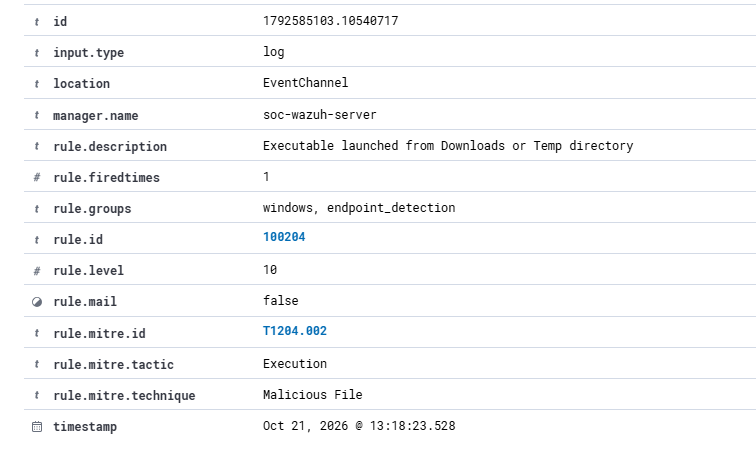

One thing I noticed was that Sysmon still recorded the original filename as `whoami.exe`, even though I had renamed the executable.

This could be useful during an investigation because the filename displayed in Windows may not always reflect the executable's original identity.

The test used a legitimate Windows executable, so the alert was expected and did not indicate actual malware.

---

## Results

All five custom rules successfully detected the activity they were designed to identify.

| Rule | Detection | Event ID | Alert Level | Result |
|---|---|---|---|---|
| `100200` | CMD launching Whoami | 4688 | 5 | Detected |
| `100201` | CMD launching Ipconfig | 4688 | 5 | Detected |
| `100202` | Document application launching encoded PowerShell | Sysmon 1 | 12 | Detected |
| `100203` | PowerShell outbound TCP connection | Sysmon 3 | 10 | Detected |
| `100204` | Executable launched from Downloads or Temp | Sysmon 1 | 10 | Detected |

The first two rules focused on basic process discovery activity, while the other three covered more suspicious behaviour.

I also tested how changing the parent process affected rule matching.

One limitation is that these rules detect specific behaviour rather than confirming malicious activity. For example, PowerShell can make legitimate network connections, and executables can run from Downloads for normal reasons.

These alerts would need further investigation before deciding whether the activity was malicious.

---

## What I Learned

Day 3 gave me more experience creating and testing custom Wazuh detection rules.

I learned how to:

- Turn threat hunting findings into detection rules
- Use Windows Security Event ID 4688 for process-based detections
- Use Sysmon Event IDs 1 and 3 for process creation and network activity
- Create rules using process names, parent processes, command lines and network fields
- Validate Wazuh rules before restarting the manager
- Generate controlled activity to test detections
- Compare different process relationships using negative testing
- Use MITRE ATT&CK mappings to understand what behaviour a rule is detecting
- Understand why an alert does not always mean malicious activity

This built on the threat hunting work from Day 2 by moving from investigating endpoint activity to creating custom detections.
