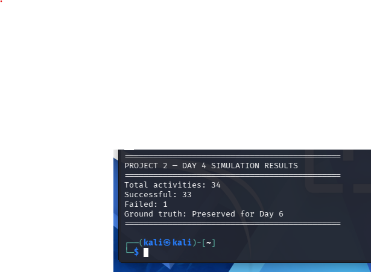
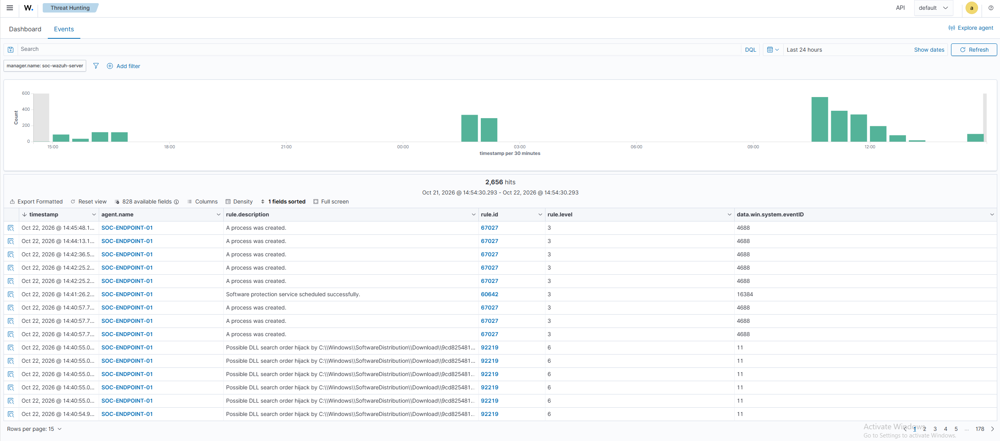
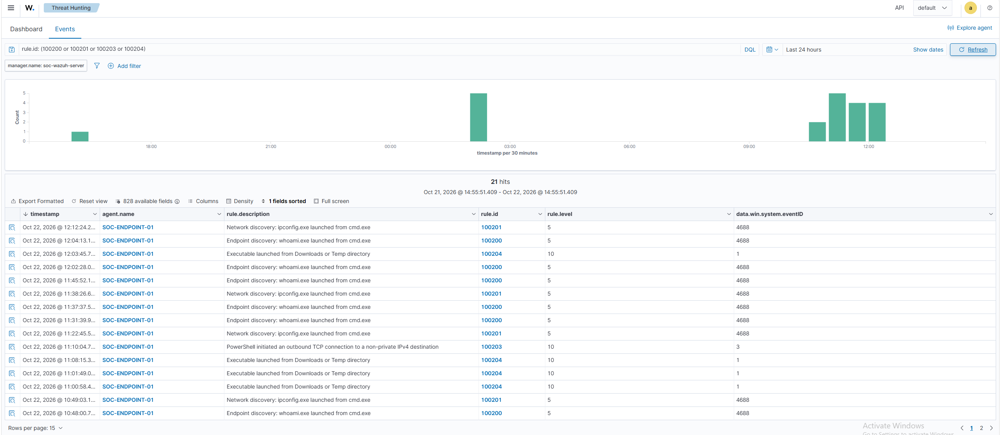

# Day 4 – SOC Activity Simulation and Detection Validation

## Objective

The aim of Day 4 was to generate realistic endpoint activity in the SOC lab and verify that the custom Wazuh detection rules created during day 3 were producing alerts.

I used a python script to automate a mixture of routine administrative commands and simulated suspicious activity against the Windows 11 endpoint.

The simulation was designed to provide security events for the investigations planned for Day 5, including timeline reconstruction, process correlation and analysis of potentially suspicious behaviour.

---

## Simulation Environment

The simulation used the existing SOC lab environment:

- **Kali Linux** – Ran the python simulation and executed commands remotely.
- **Windows 11 (SOC-ENDPOINT-01)** – Target endpoint generating security events.
- **Wazuh Manager** – Collected and analysed endpoint telemetry.
- **Windows Security Auditing** – Recorded process creation and security activity.
- **Sysmon** – Provided additional process and network telemetry.

SSH was used to execute commands remotely from Kali Linux on the Windows endpoint.

---

## Python Simulation

I used a python script called `simulation.py` to automate activity over approximately 60 minutes.

The script used:

- `subprocess` to execute commands remotely through SSH.
- `random` to randomise activity scheduling.
- `time` to control execution intervals.
- `datetime` to record timestamps.
- `csv` to log execution results.
- `pathlib` to manage file paths.

The simulation consisted of 34 scheduled activities:

- 23 background activities.
- 11 activities distributed across three simulated scenarios.

The background activity included routine commands such as `hostname`, `tasklist`, `systeminfo`, `Get-Service` and `Get-Date`.

Some background activities also included authorised executions of `whoami.exe` and `ipconfig.exe`, allowing custom detection rules to trigger during legitimate activity.

This was intended to create a more realistic investigation environment where an alert does not automatically indicate malicious behaviour.

The simulation script is available here:

[View python simulation script](../../screenshots/project-02/day-04/simulation.py)

---

## Simulated Activity Scenarios

Three controlled scenarios were included in the simulation.

### Scenario 1 – Account and System Reconnaissance

The first scenario simulated account and system discovery using Windows commands.

Activities included:

- `whoami.exe` – Identity discovery.
- `net user` – Local account enumeration.
- `net localgroup administrators` – Administrator group enumeration.
- `ipconfig.exe` – Network configuration discovery.

The objective was to generate related process creation events that could later be correlated into an investigation timeline.

### Scenario 2 – PowerShell and Network Activity

The second scenario simulated PowerShell execution and outbound network activity.

Activities included:

- Encoded PowerShell execution.
- PowerShell process discovery using `Get-Process`.
- An outbound HTTPS request using `Invoke-WebRequest`.

The encoded PowerShell command performed a harmless date query.

The objective was to generate PowerShell execution and network events for subsequent investigation.

### Scenario 3 – Executable Staging and Privilege Discovery

The third scenario simulated executable staging and additional system discovery.

Activities included:

- Copying the legitimate Windows `whoami.exe` executable into the Downloads directory as `lab-test.exe`.
- Executing the copied file.
- Running `whoami /priv` to enumerate privileges.
- Running `netstat -ano` to inspect network connections.

This scenario was designed to test detection of executables launched from unusual directories and provide additional process activity for correlation.

All three scenarios used controlled commands. No malware deployment or exploitation was performed.

---

## Activity Scheduling and Execution

The python script assigned the three scenarios to randomised time windows during the simulation.

Related commands within each scenario were separated by short delays, while background activities were distributed throughout the hour.

Before execution, the script checked SSH connectivity to the Windows endpoint.

For each activity, the script recorded:

- Start and end timestamps.
- Activity description.
- Executed command.
- Associated scenario.
- Intended detection rule.
- Execution exit code.
- Execution status.
- Error information,where available.

These details were written to a separate `ground_truth.csv` file.

The ground-truth file was preserved to allow comparison between the simulation's recorded activity and the findings from the blind SOC investigation.

---

## Simulation Results

The simulation completed with the following results:

| Metric | Result |
|---|---|
| Scheduled activities | 34 |
| Successful executions | 33 |
| Failed executions | 1 |
| Simulation duration | Approximately 60 minutes |
| Simulated scenarios | 3 |
| Background activities | 23 |

The simulation completed and the ground-truth file was preserved.

---

## Wazuh Event Collection

After the simulation, I reviewed the collected events in Wazuh Threat Hunting.

The event overview displayed 2,656 alerts within the selected 24-hour monitoring window.

The event table included:

- Event timestamps.
- Agent names.
- Rule descriptions.
- Rule IDs.
- Rule severity levels.
- Windows Event IDs.

The visible records included Windows process creation events, which can be used to investigate command execution and process relationships.

The 2,656 alerts represented the wider 24-hour monitoring period and were not all attributed to the simulation.

---

## Custom Detection Results

I filtered the Wazuh events using the four custom rules targeted by the simulation:

- `100200` – `whoami.exe` launched from `cmd.exe`.
- `100201` – `ipconfig.exe` launched from `cmd.exe`.
- `100203` – PowerShell initiating an outbound TCP connection to a non-private IPv4 destination.
- `100204` – Executable launched from Downloads or temporary directories.

The filtered results displayed 21 matching alerts within the selected 24-hour period.

All four targeted rules appeared in the results.

The alerts included Windows Security Event ID 4688 and Sysmon event IDs 1 and 3.

These results confirmed that the custom rules were generating alerts for the monitored endpoint.

The investigation stage will examine individual events and their timestamps to establish which activities can be correlated.

---

## Observations

Several observations were made during Day 4.

**1. Automated activity generation**

The python script successfully executed 33 of the 34 scheduled activities, demonstrating that the lab could generate repeatable endpoint activity without manually entering every command.

**2. Custom detection functionality**

All four targeted custom Wazuh rules appeared in the filtered alert results.

**3. Background activity and detection context**

The simulation deliberately included legitimate commands that could trigger custom detection rules.

This highlighted the importance of investigating surrounding activity rather than relying solely on alert descriptions.

**4. Available investigation telemetry**

Windows Security and Sysmon events provided a foundation for examining process execution, command lines and network activity.

**5. Investigation limitations**

The initial screenshots covered a 24-hour period rather than only the simulation window.

One simulated activity also failed, and its cause was not determined from the execution summary.

These limitations will need to be considered when evaluating detection coverage and reconstructing events.

---

## Preparation for Day 5

The simulation generated endpoint activity that can be used for a blind SOC investigation.

The next stage will focus on:

- Identifying suspicious events within the Wazuh timeline.
- Correlating related process creation events.
- Reconstructing process relationships using Windows Security and Sysmon telemetry.
- Examining PowerShell and network activity.
- Building chronological investigation timelines.
- Distinguishing suspicious activity from legitimate background activity.
- Documenting findings, uncertainties and detection gaps.

This will allow the initial investigation to be performed using the available security telemetry rather than knowledge of the simulation's intended scenarios.

---

## Day 4 Outcome

Day 4 established an automated activity simulation within the SOC lab.

The Python script completed 33 of 34 scheduled activities, and Wazuh displayed alerts from all four targeted custom detection rules.

The collected events provides a basis for further investigation, although individual alerts still need to be correlated with the simulation timeline.

The next stage is to investigate the events as a SOC analyst would, using process relationships, timestamps and supporting evidence to determine what occurred.
